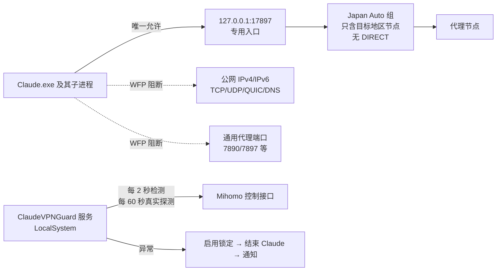

# Claude VPN Guard

> Windows 上的「按程序」网络隔离器：让 Claude 桌面版（含内置 Claude Code）**只能**经过指定的代理出口联网；代理异常时，先断网再关闭 Claude，绝不回退直连。

*A per-application network kill switch for the Claude desktop app on Windows. It uses persistent WFP filters and firewall rules so Claude can only reach a dedicated Mihomo (Clash) listener. When the proxy breaks, Claude is blocked first and closed second; it never falls back to a direct connection.*

   

当前版本：**2.3.2**（2026-11-02）。各版本改动见 [CHANGELOG.md](CHANGELOG.md)。

**手机版（Android）**：网关卫士 0.3.0，APK 在 [Releases](https://github.com/tianhuojeff/claude-vpn-guard/releases/tag/android-v0.3.0)，说明见 [docs/手机版说明.md](docs/手机版说明.md)，源码在 [`android/`](android)。

---

## 为什么要做

常见的「系统代理 + 规则分流」对某一个应用来说是**软约束**：
- 系统代理被关；
- Clash 内核崩溃；
- Chromium 回退 DIRECT；
- IPv6 / QUIC / 应用自带 DNS 绕过；
- 规则或 GLOBAL 被误切到直连。

出现以上任意一种情况，这个应用的流量就会直接走真实网络，用户往往毫无察觉。

本项目把约束改成**硬约束**：在 Windows 内核网络层（WFP）按程序拦截，Claude 的进程除了一个专用代理入口之外**哪里都连不上**。其他程序完全不受影响。

## 设计原则

**默认拒绝 → 先阻断网络 → 再结束进程 → 验证安全后才放行。**



## 主要功能

| 层 | 机制 |
|---|---|
| **专用入口** | 通过 Clash Verge Rev 的全局扩展脚本，注入一个只含目标地区节点的 `Japan Auto` 组和独立监听 `127.0.0.1:17897`。实测：即使模式切成 direct、GLOBAL 选了 DIRECT，专用入口仍只走该组。 |
| **WFP 持久过滤器** | 无需驱动。每个过滤器都带 `ALE_APP_ID` 条件，只匹配经核实的 Claude 可执行文件。Claude 只能连专用入口；回环上的其他代理端口、公网 IPv4/IPv6、TCP/UDP 一律拒绝。过滤器持久保存，服务崩溃、重启期间仍然有效。 |
| **锁定规则** | 服务启动、网络切换、休眠恢复或任何异常时，**先**阻断 Claude 的全部地址，验证通过后才解除。 |
| **检测 + 保护性关闭** | 每 2 秒检查 Mihomo 的模式、出站链和 Claude 的真实连接；每 60 秒经代理做一次 TLS 真实探测，并核对出口国家。内核退出靠进程句柄等待发现，实测约 10 ms。 |
| **节点故障转移** | 多路存活探测，并行预检候选节点，验证出口国家与实际路径。目标地区节点全部失败时锁网并关闭 Claude，**绝不**换到其他国家或直连。 |
| **事务性安装 / 完整卸载** | 安装失败自动回滚。`full-uninstall.ps1` 只用系统 PowerShell 即可删除全部 WFP 过滤器与规则，不依赖本程序的 exe 能否运行。 |
| **覆写自愈** | 订阅定时更新后若 Clash 配置丢了专用入口，服务自动补写全局扩展脚本，并对运行配置做相同改动后让内核重载，不用手动刷新。期间 Claude 始终处于阻断状态。 |
| **GUI** | 托盘常驻，包括状态总览、节点管理和参数设置，可「启动 Claude」（带专用代理参数）。另有 5 步安装与验收向导。 |

## 验证情况

以下都在真实 Windows 11 + Clash Verge Rev 环境里跑过（详见 [docs/V2整合清单.md](docs/V2整合清单.md)）：

- 单元测试与故障注入实验台：109 项通过（含真实 Mihomo 内核解析校验）。
- WFP 实测 `selftest`：31 项通过、0 失败。覆盖回环端口隔离、IPv4/IPv6、UDP/DNS、借道局域网，以及崩溃后的持久性。
- 场景验收：关闭系统代理、切换节点、内核崩溃（39 ms 发现，约 1.1 s 完成关闭 Claude）、真实环境下自动换节点，全部通过。
- 防火墙审计：每个过滤器都带程序条件，不改系统默认策略，不影响局域网与其他程序。
- 已知限制单独列出，没有掩盖：[docs/已知安全限制.md](docs/已知安全限制.md)。例如 Claude 的 Hyper-V 虚拟机流量经 NAT 发出，不归属于 Claude 进程。

> `selftest` 通过 ≠ 正式 Claude 已被隔离。安装后应再用 `diag` 确认真实 Claude 的连接全部经专用入口。

## 构建与安装

需要 Windows 10/11，系统自带 .NET Framework 4.8 和 `csc.exe`，**不用另装 SDK**。

```powershell
# 构建并运行单元测试，输出到 dist\
powershell -ExecutionPolicy Bypass -File scripts\build.ps1 -RunTests

# 推荐：运行安装与验收向导（需要管理员），按 5 步走：预检 → 实测 → Clash 覆写 → 安装 → 场景验收
dist\ClaudeVPNGuard-Setup.exe
```

⚠️ **注意**
- 本程序会在系统里写入持久的 WFP 过滤器和防火墙规则。请先读 [docs/设计说明.md](docs/设计说明.md)，确认知道怎么卸载再安装。
- 自行编译的 exe 没有代码签名。开启了「智能应用控制」(Smart App Control) 的系统可能拦截服务启动。安装器会先探测，探测失败就不安装。
- 应急恢复：管理员 PowerShell 执行 `scripts\full-uninstall.ps1`（加 `-DryRun` 只检查）。

## 命令行（`ClaudeVPNGuard.Service.exe`）

| 命令 | 作用 |
|---|---|
| `preflight` / `audit` | 只读：安装前检查、防火墙与 WFP 审计 |
| `selftest` | 用替身程序套用与 Claude 相同的规则，真实测试阻断效果，测完清理 |
| `diag` | 只读诊断：Claude 每条连接的去向、Mihomo 出站链、出口国家 |
| `install` / `verify` / `uninstall` | 安装、校验、卸载服务与规则 |
| `verge-apply` / `verge-diff` / `verge-remove` | 写入、比较、撤销 Clash Verge 覆写（写入前先备份） |

## 项目结构

```
src/Core      引擎：WFP、防火墙、Mihomo 客户端、节点管理、Clash Verge 覆写
src/Service   Windows 服务与命令行（预检/审计/实测/诊断）
src/Gui       托盘界面与节点管理页
src/Setup     安装与验收向导
tests         单元测试 + 真实 Mihomo 内核的故障注入实验台
scripts       构建、安装、卸载、应急恢复、验收脚本
docs          设计说明、安全限制、各项测试报告
android       手机版（网关卫士，Kotlin）
```

## 文档

- [设计说明](docs/设计说明.md)：网络路径分析、TUN 与系统代理对比、架构
- [已知安全限制](docs/已知安全限制.md)
- [手机版说明](docs/手机版说明.md)：Android 网关卫士的原理、首次使用、构建和更新日志
- [V2 整合清单](docs/V2整合清单.md)：每项功能的实现、自动化测试和真实环境验证状态
- [防火墙审计](docs/防火墙审计报告.md) · [节点切换测试](docs/节点切换测试报告.md) · [故障响应时间](docs/故障响应时间报告.md) · [测试报告](docs/测试报告.md)

## 路线图

- [x] 桌面端（Windows）：WFP 隔离 + 专用入口 + 故障转移
- [x] 订阅定时更新后自动补写并套用覆写，免手动刷新（2.3.0）
- [ ] 代码签名，兼容智能应用控制
- [x] 多订阅聚合目标地区节点（2.1.0）
- [x] 手机端（Android / FlClash）：不 root，按应用断网；卫士生成总配置，Claude 只走日本节点（0.3.0）

## 声明

这是个人项目，与 Anthropic 及 Clash/Mihomo 项目没有关系。请在遵守当地法律和各服务条款的前提下使用。

## 许可证

[MIT](LICENSE)

本项目在 AI 编程助手 Claude Code 协助下开发。
