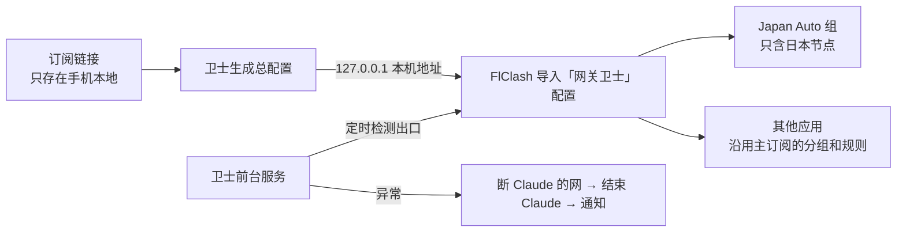

# 手机版：网关卫士（Android）

和桌面端同一个目标：手机上的 Claude 只能经日本节点联网；出口异常时先断 Claude 的网、再结束 Claude，绝不回退直连。其他应用照常。

- 当前版本：**0.3.0**（2026-11-03）
- 下载：[Releases → android-v0.3.0](https://github.com/tianhuojeff/claude-vpn-guard/releases/tag/android-v0.3.0) 里的 `ClaudeVPNGuard-Android-0.3.0.apk`
- 源码：仓库的 [`android/`](../android) 目录
- 需要：Android 11 及以上；代理客户端 [FlClash](https://github.com/chen08209/FlClash)（Mihomo 内核）；按应用断网需要 [Shizuku](https://shizuku.rikka.app/) 或 root

## 怎么工作



1. **订阅与总配置**：把一个或多个订阅链接粘贴进卫士，链接只存在应用私有存储里，界面只显示域名。卫士以第一个订阅（主订阅）为底，把所有订阅里的日本节点并进 `Japan Auto` 组（url-test 自动选最快），Claude 的域名和包名规则排在最前面走这个组。卫士在本机 `127.0.0.1` 上提供这份配置（地址带随机令牌），FlClash 导入后自动更新。
2. **只走日本**：`Japan Auto` 组里只有日本节点，没有 DIRECT、也没有其他国家。日本节点全部不可用时 Claude 的连接直接失败。一个日本节点都没有时，组里只放 REJECT。
3. **按应用断网**：
   - 有 Shizuku 或 root：用系统防火墙链按 UID 断 Claude 的全部流量（连本机代理端口也连不上）。卫士启动时先锁，检测连续通过才放行。
   - 都没有：兜底模式，用无障碍服务在锁定时把 Claude 退回桌面并结束。
   - Android 12 及以下没有这条防火墙链，改用「暂停应用」。
4. **检测**：经 FlClash 代理和经系统默认网络（VPN）访问 claude.ai 等站点的 `/cdn-cgi/trace`，要求出口在日本、且不是本机真实地址。VPN 断开或被换成别的应用时立即触发。

## 首次使用

打开卫士会先进设置向导（以后可在「设置 → 重走设置向导」再走一遍），每一步都显示是否已完成：

1. Root 或 Shizuku 授权（没有就走兜底模式）
2. 省电策略设为「无限制」
3. 兜底无障碍服务（可选）
4. 导入订阅
5. 让 FlClash 导入卫士的配置（点「导入到 FlClash」，在 FlClash 里确认）
6. 在 FlClash 的配置列表里选中「网关卫士」
7. 启动卫士
8. FlClash 打开外部控制器（可选，打开后首页能显示 Japan Auto 当前选中的节点）

## 首页

只放状态：保护状态和出口、FlClash 是否在用卫士配置、Japan Auto 当前节点、各订阅的日本节点数和流量到期、Claude 是否允许联网、最近一次保护性关闭。按钮：启动 Claude（先检测，通过才放行）、立即检测、订阅与节点、设置。

## 卸载

先在「设置」里点「停止卫士并还原网络」，再卸载。如果锁定中直接卸载，Claude 会一直断网，直到手机重启，或在电脑上执行：

```
adb shell cmd connectivity set-package-networking-enabled true com.anthropic.claude
```

## 构建

JDK 17、Android SDK 36、Gradle 8.14：

```
cd android
echo "sdk.dir=<你的 Android SDK 路径>" > local.properties
gradle assembleRelease
```

Release 版用调试密钥签名，只适合自己侧载安装。

## 已知限制

- 网页版 Claude 只能靠 FlClash 的域名规则；防火墙只能按整个应用断网，选择保护浏览器会断掉整个浏览器。
- 手机重启后，系统防火墙的拒绝位会清空，Shizuku 也要重新启动；Shizuku 起来之前由兜底模式保护。
- 部分国产系统（HyperOS 等）要手动给卫士和 Shizuku 打开「自启动」和「后台弹出界面」。

## 更新日志

### 0.3.0（2026-11-03）

- 首页改成状态看板；设置步骤移到首次向导，可从设置里重走。
- 新增「订阅与节点」：多订阅导入、设主订阅、全部更新；卫士本机生成总配置给 FlClash，Claude 只走 Japan Auto。
- 修复：Japan Auto 曾把 REJECT 放在第一位，内核测速前会先选它，导致日本节点正常时 Claude 也被拒绝。现在组里只放日本节点。
- 修复：Android 默认禁止明文 HTTP，首页「是否在用卫士配置」的探测一直失败；现在只对探针域名和本机放行明文。

### 0.2.0（2026-11-02）

- 支持 root；探测出错先重试，只有真的出现非日本出口或整条路径都没有日本结果才锁。
- Android 12 及以下用「暂停应用」代替防火墙链。

### 0.1.0（2026-11-02）

- 首个版本：Shizuku 按应用断网、出口检测、兜底无障碍模式、开机自启。
